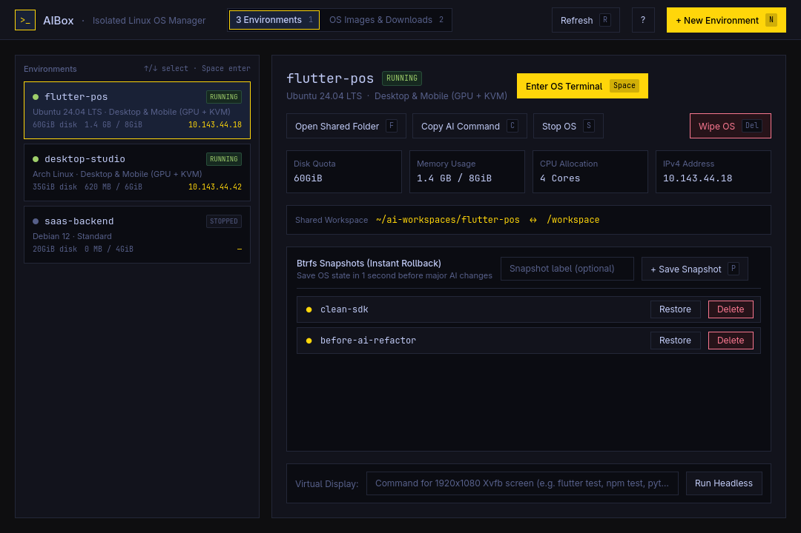

# AIBox



**AIBox** is a native desktop application for **Omarchy** (C++17 & Qt Quick 6) that manages isolated Linux OS environments (powered by **Incus**, **Btrfs**, **KVM**, and **GPU Passthrough**) for large-scale AI, Desktop App, and Mobile App projects without polluting or risking your host operating system.

---

## Key Features

- **Native Omarchy Look & Feel**: Automatically follows your active Omarchy theme accent (`~/.local/state/omarchy/current/theme/colors.toml`) and Hyprland window rounding in real time.
- **Full OS Environment Management**:
  - View all created environments with live status (`RUNNING` / `STOPPED`), disk quota, memory usage, CPU core allocation, and IPv4 address.
  - **Custom Hardware Quotas & Capability Presets**: Choose between **Desktop & Mobile (GPU + KVM + GUI Bridge)**, **Standard AI / Web (Docker)**, or **Full KVM Virtual Machine (`--vm`)**, and set strict Disk (`20GiB`–`100GiB`), RAM (`4GiB`–`12GiB`), and CPU core limits upfront.
- **OS Image Catalog & One-Tap Local Cache**:
  - Includes a curated catalog of popular Linux distributions (**Ubuntu 24.04 LTS**, **Ubuntu 22.04 LTS**, **Debian 12**, **Arch Linux**, **Fedora 41**, **Alpine Linux 3.21**, **Kali Linux**, **Rocky Linux 9**).
  - Pre-download OS images into local storage so new environments launch in under **1 second**.
- **Real-Time Progress, Cancellation, & Background Persistence**:
  - Live step-by-step progress bar (`0%–100%`) and terminal output stream during environment creation and OS downloads, with an instant **Cancel** button that cleans up partial state.
  - Runs long tasks in a detached background session (`setsid`): if you close the GUI window while an environment is being created, it continues safely in the background, sends a desktop notification (`notify-send`) upon completion, and automatically re-attaches to the progress bar when you reopen AIBox.
- **Seamless Two-Way Shared Workspace (`/workspace`)**:
  - Every environment automatically mounts `~/ai-workspaces/<project-name>` on the Host to `/workspace` inside the isolated OS with synchronized permissions (POSIX ACL + UID shifting).
- **1-Second Btrfs Snapshots (Time Machine) & Clean Wipe**:
  - Save the entire OS state in 1 second before letting an autonomous AI agent perform major system changes, restore any snapshot instantly, or wipe the entire OS clean in 1 second when the project is complete.
- **Headless Virtual Display Runner (`Xvfb`)**:
  - Run automated GUI tests (`flutter test`, `npm test`, `pytest`) inside a `1920x1080` virtual screen inside the container without hijacking your host cursor or display.

---

## Keyboard Shortcuts

| Key | Action |
| :--- | :--- |
| `Space` / `Enter` | Enter the selected OS terminal directly at `/workspace` |
| `N` | Create a new isolated Linux OS environment |
| `F` | Open the shared workspace folder in the Host file manager |
| `S` | Start or stop the selected environment (0% RAM/CPU when stopped) |
| `P` | Save an instant 1-second Btrfs snapshot |
| `C` | Copy the AI agent execution command (`incus exec <name> --cwd /workspace -- bash`) |
| `Delete` | Wipe / destroy the selected environment completely |
| `1` / `2` | Switch between **Environments** and **OS Images & Downloads** tabs |
| `↑` / `↓` | Select previous / next environment |
| `R` | Refresh environment status and cached OS images |
| `?` | Toggle the keyboard shortcuts overlay |
| `Esc` | Close active dialog or minimize progress modal |
| `Q` | Quit AIBox |

---

## Clean Setup & Installation (New Machine / Re-setup)

All source code and system setup scripts are self-contained in this Git repository (`~/Work/aibox`).

### 1. Initialize Host System & Incus (Run Once)
Installs Incus, enables the native Btrfs storage pool with disk quotas, configures UFW firewall rules for `incusbr0`, and creates the `ai-gui` GPU/KVM passthrough profile:
```bash
cd ~/Work/aibox
./bin/setup-system
```

### 2. Build & Install the Desktop Application (`aibox`)
Compiles the C++/Qt6 application into a single binary and installs it as a native Arch Linux (`pacman`) package along with its icon and **Omarchy App Launcher (`Super + Space`)** entry:
```bash
cd ~/Work/aibox
./bin/install
```

### 3. Run Unit Tests
```bash
cd ~/Work/aibox
./bin/test
```

---

## Clean Uninstallation (Zero Leftovers)

Because AIBox is installed as a tracked `pacman` package, you can remove it cleanly at any time:

* **Uninstall the AIBox Desktop App & App Launcher Shortcut Only** (keeps Incus and your environments intact):
  ```bash
  cd ~/Work/aibox
  ./bin/uninstall
  # or directly via pacman:
  sudo pacman -Rns aibox
  ```

* **Full Uninstall (Removes AIBox + Incus + All Containers)**:
  ```bash
  cd ~/Work/aibox
  ./bin/uninstall --full
  ```
