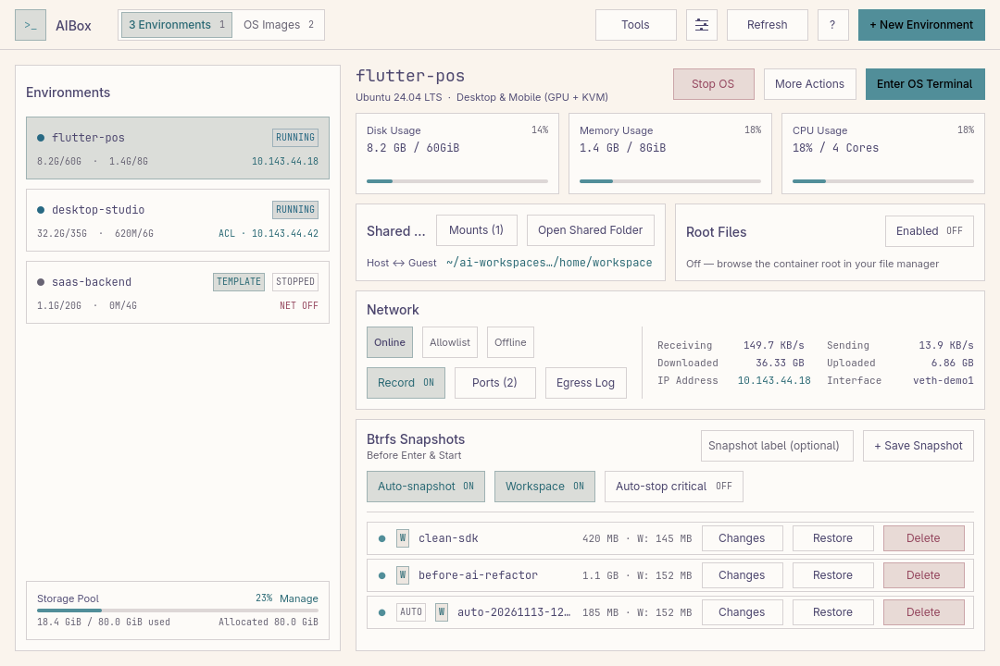

# AIBox

AIBox is a native Qt Quick desktop app for managing isolated Linux environments with Incus on Omarchy/Arch Linux.



## Features

- Create and manage Linux containers and virtual machines with configurable CPU, memory, and disk limits.
- Monitor disk usage, memory usage, and CPU usage in compact task-manager style cards. Click the CPU card to expand or collapse two-column per-core usage bars for the selected environment.
- A single **Tools** menu groups global Secrets, Backups, History, and the Stale & Orphans report, while secondary environment actions (clone, quotas, template, copy AI command, paste image, environment secrets, and the destructive **Wipe OS**) live in **More Actions**, with **Wipe OS** last and in danger styling. The environment inspector keeps only start/stop and enter.
- Share a project workspace with environments at `/home/workspace` and open it directly on the host. The Create dialog can place a new workspace in a custom folder; an empty field keeps the configured default (`<system>/workspaces/<name>`).
- Browse an environment's **entire root filesystem** from the host file manager: **Root Files** (under Shared Workspace) starts a passwordless, `127.0.0.1`-only SFTP listener through `incus file mount`, shows a copyable `sftp://root@127.0.0.1:<port>/` URL, and opens it with one click. It stops automatically when the environment stops, and the listener survives AIBox restarts until disabled.
- Cache OS images, track task progress, and resume background operations.
- Save, restore, and automate paired Btrfs snapshots (OS container + `/home/workspace` subvolume, with **Both / System only / Workspace only** restore and `pre-restore` safety snapshots) and configurable retention before entering or starting environments.
- Inspect `/home/workspace` added/modified/deleted files and unified diffs since any workspace snapshot (`V`), configure exclude patterns, and restore individual files without rolling back the whole environment.
- Automate workflows and git hooks from plain terminals with the headless CLI (`enter`, `exec`, `start`, `stop`, `snapshot`, `snapshots`, `restore`, `diff`, `list`, `check`) using `--project <dir>`, task locking, and auto-snapshot/allowlist guardrails.
- Store global API keys on the host in `~/.config/aibox/secrets.json` (`0600`) and inject selected secrets per environment only at `exec` runtime (`A`) with automatic log redaction and zero exposure in `/home/workspace`, snapshots, clones, or backups. Global secrets are managed in **Tools → Secrets**; the checkbox there controls whether a secret appears in environment dialogs. Each environment chooses which visible global secrets it uses with its own checkbox. Hiding a global secret in Tools also clears it from every environment binding, so it cannot stay silently assigned. Each environment can also hold secrets that only it receives, managed from **More Actions → Secrets** and stored in `~/.config/aibox/secrets.d/<env>.json` (`0600`); these are enabled by default, toggle with their checkbox, and can be deleted, while global secrets cannot be deleted from that view. Wiping the environment also removes its secret file.
- Clone environments in seconds with isolated workspaces and mark environments as reusable templates.
- Control per-environment network access (`Online`, IP-based `Allowlist` via Incus Network ACLs, or `Offline` kill switch), record outbound connections via **Egress Log**, and allow destinations with one click.
- Enforce per-container process caps (`limits.processes`) and root disk I/O bandwidth limits (`limits.read` / `limits.write`), edit CPU/RAM/disk/I/O quotas on existing environments (`E`), monitor storage pool capacity with overcommit warnings in **Create** / **Quotas** and `aibox check` (`pool_capacity`), grow loop-file backed pools from **Settings → Storage Pool** (grow-only, validated and confirmed, hides the control for directory-backed pools), monitor disk/CPU/RAM thresholds with a debounced desktop watchdog + opt-in critical auto-stop, optionally auto-stop idle environments while the GUI is running (`idleStopMinutes`, per-env `user.aibox.idlestop`, active `incus exec` / port-forward guards, 1-min desktop warning, auto-snapshot before stop), and view per-snapshot disk sizes.
- Forward container ports safely to `127.0.0.1` (**Ports**), attach read-only extra host folders under `/home/workspace/<name>` with system/sensitive path protection (**Extra Mounts**), and edit CPU/RAM/disk/I/O quotas on existing environments.
- Inspect the last 50 background operations and tail-capped logs in the **Operation History** viewer (`H`), plus opt-in interactive **Session Recording** (`script -q -f`, `user.aibox.record`, automatic S3 secret redaction, 20-per-env / 200 MB retention, ANSI-stripped 200 KB log viewer, and `scriptreplay` terminal replay) under **History (`H`) → Sessions**. The `History (N!)` failure badge clears as soon as the viewer is opened, without deleting any entries.
- Export environments and `/home/workspace` directories to compressed archives with pre-flight free-space checks, import backups into new isolated environments (`B`), audit unused environments (`staleDays`) alongside orphaned workspaces, snapshots, and unpaired backups with verified **Export & Wipe** (`U`); orphan cleanup falls back to **Delete as admin** (terminal `sudo`) when container-written files are root-owned, the error banner offers a **Copy Fix** button for the exact admin command, and host setup issues are diagnosed/repaired with `aibox check --fix`.
- Follow the active Omarchy theme (live light/dark palette, window rounding, and adaptive desktop/launcher icon via `~/.config/omarchy/hooks/theme-set.d/50-aibox-icon` and `aibox theme render-icon`; remove or `chmod -x` that hook file to keep the static fallback icon).

## Requirements

- Omarchy or Arch Linux
- Incus and a Btrfs storage pool
- Qt 6 (`qt6-base`, `qt6-declarative`) and Rust toolchain (`cargo`, `rustc`) to build

## Setup and install

On a new machine, configure Incus and required host settings:

```bash
./bin/setup-system
```

Build and install the application into `~/.local/` (no `sudo` required):

```bash
./bin/install
```

Run the test suite:

```bash
./bin/test
```

## Usage

Launch **AIBox** from the app launcher (`Super` + `Space`). On first launch, choose the system storage location (defaulting to `~/aibox/`, containing `workspaces/`, `os-images/`, `state/`, and `config.json`) before clicking **Continue**; this choice is remembered in `~/.config/aibox/location.json`. The top **Tools** button opens global Secrets, Backups, History, and Stale & Orphans. Use **More Actions → Secrets** on an environment to view global secrets read-only and add secrets that only that environment receives. The configuration menu is split by responsibility: **Locations** (system root, workspace folder, OS image storage), **Storage Pool** (live pool usage and in-place growth), **OS Catalog**, **Create Options**, and **Safety**. **Settings → Storage Pool** shows live pool usage and can grow a loop-file backed pool in place (for example `30GiB` → `60GiB`); directory-backed pools follow the host filesystem and hide the growth controls. **Settings → Create Options** stores the disk quota, RAM, and CPU choices as chips: type a number and press `Enter` to add one (units such as `GiB` are appended automatically), with up to 4 choices per list and `×` to remove a chip.

To browse an environment's root filesystem in your file manager, use the **Root Files** row under **Shared Workspace**. **Enable** starts a localhost-only SFTP listener and shows a click-to-copy URL such as `sftp://root@127.0.0.1:2222/`; **Open** hands it to the default file manager, and **Disable** stops the listener. Access requires the environment to be running, and it is stopped automatically when the environment stops.

For headless scripting and terminal workflows, use `aibox [--project <dir>] <command>`:

- `aibox enter <env>` / `aibox exec <env> -- <cmd...>` — run pre-steps (auto-snapshot, allowlist refresh, auto-start) and attach or run a command in `/home/workspace`
- `aibox start <env>` / `aibox stop <env>` — start (with auto-snapshot & allowlist refresh) or stop an environment
- `aibox snapshot <env> [name]` / `aibox snapshots <env> [--json]` — create or list paired OS + `/home/workspace` snapshots
- `aibox restore <env> <snap> [--system-only|--workspace-only] [--yes]` — restore snapshot with safety backup
- `aibox diff <env> [snap] [--json]` — review `/home/workspace` changes since a snapshot
- `aibox list [--json]` / `aibox check [--fix] [--json]` / `aibox help [command]` — list environments, run diagnostics, or view usage

## Keyboard Shortcuts

| Key | Action |
| :--- | :--- |
| `Space` / `Enter` | Enter selected OS terminal in `/home/workspace` |
| `N` | Create a new isolated OS environment |
| `F` | Open shared workspace folder on Host |
| `S` | Start or stop selected environment |
| `P` | Create instant 1-second Btrfs snapshot |
| `V` | Review `/home/workspace` changes since a snapshot |
| `D` | Clone selected environment |
| `E` | Edit quotas and limits of selected environment |
| `T` | Mark or unmark environment as template |
| `K` | Kill or restore environment network |
| `C` | Copy AI agent execution command |
| `I` | Save clipboard image to workspace and copy its path |
| `A` | Manage global secrets and per-environment secret bindings |
| `H` | View operation history and full task logs |
| `B` | Export and import environment backups |
| `U` | Inspect stale environments and orphaned disk artifacts |
| `Delete` | Wipe / destroy selected environment |
| `1` / `2` | Switch between Environments and OS Catalog |
| `3` | Open the configuration menu |
| `R` | Refresh status and disk usage |
| `?` | Toggle keyboard shortcuts overlay |
| `Ctrl+Shift+T` | Toggle theme token debug overlay |
| `Q` | Quit AIBox |

## Development

```bash
./bin/build     # compile into rust/target/release/aibox (fast loop)
./bin/test      # run fmt, clippy, and the Rust/Qt/QML test suite
./bin/install   # build and install into ~/.local/ (or --system for makepkg)
```

Source layout:

- `rust/crates/aibox-core/` holds the pure Rust core (config, secrets,
  snapshots, workspace, network, backup, health, provisioning, Incus parsing,
  task runtime, `Engine`, and headless CLI) plus golden replay tests.
- `rust/crates/aibox-app/` holds the `cxx-qt` QObject bindings (`Backend`,
  `Theme`, `TranslatorState`), `main.rs`, tiny Qt C++ shims (`cpp/`), and
  offscreen QObject/QML smoke tests (`tests/`).
- `src/qml/` holds the interface: `Main.qml` is the window shell, with reusable
  controls in `components/`, modal overlays in `dialogs/`, and layout sections
  in `panels/` (configuration sections live in `panels/settings/`).
- `src/qml/components/Style.qml` is the design-token singleton: surfaces,
  spacing, type scale, radii, control sizes and modal metrics. `ModalDialog` is
  the shared modal shell, so dialogs only declare their own content. Live
  Omarchy colours and rounding come from the Rust `Theme` QObject.
- `src/i18n/` holds the translation catalogs and `src/resources.qrc` bundles
  them with the QML files.

Read [AGENTS.md](AGENTS.md) before changing the code. For a quick visual smoke
test without a display:

```bash
QT_QPA_PLATFORM=offscreen AIBOX_GRAB_PATH=/tmp/aibox.png ./rust/target/release/aibox
QT_QPA_PLATFORM=offscreen AIBOX_GRAB_PATH=/tmp/aibox-create.png AIBOX_PREVIEW_CREATE=1 ./rust/target/release/aibox
QT_QPA_PLATFORM=offscreen cargo test --release --locked --manifest-path rust/Cargo.toml -p aibox-app --test theme_matrix -- --ignored
```

## Uninstall

Remove the application while keeping Incus and environments:

```bash
./bin/uninstall
```

To also remove Incus and all environments:

```bash
./bin/uninstall --full
```

## License

See [LICENSE](LICENSE).

> **Note:** Setup and uninstall scripts modify host system configuration. Review them before running.

For architecture and change history, see [CATALOG.md](CATALOG.md). Repository-specific development guidance is in [AGENTS.md](AGENTS.md).
